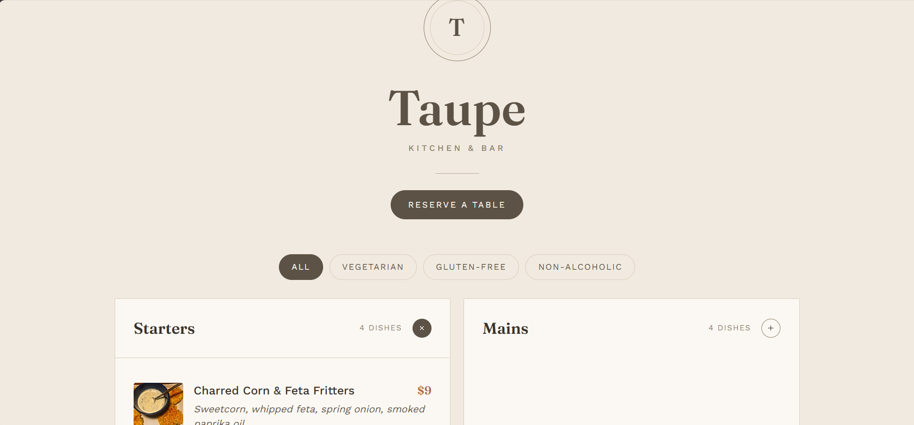

# Taupe Restaurant Menu

A responsive restaurant menu website for a fictional restaurant called **Taupe**, designed around a warm taupe colour palette. Visitors can browse the menu by category, filter by dietary option, view dish photos up close, and request a table reservation.



**Live demo:** https://daisylorreta.github.io/Taupe/

## Features

- **Expandable categories:** Starters, Mains, Desserts and Drinks. Click a category to see its dishes, each with a photo, price, description and dietary tags. Only one category stays open at a time.
- **Dietary filters:** Show only Vegetarian, Gluten-free or Non-alcoholic items. Dish counts update as you filter.
- **Photo modal:** Click any dish photo to see a larger image with the full details.
- **Reservation form:** Name, phone, date, time, guests and special requests, with validation, date and time restrictions, and a confirmation summary. The booking details can be sent to the restaurant on WhatsApp.
- **Accessible and responsive:** Works on phones and desktops, supports keyboard navigation, uses ARIA attributes and respects reduced-motion settings.

## Built With

- HTML5
- CSS3 (custom styling)
- [Bootstrap 5](https://getbootstrap.com/)
- Vanilla JavaScript
- Google Fonts (Fraunces and Work Sans)

## How to Run

No installation or build step is needed.

1. Download `index.html`.
2. Open it in any modern browser.

An internet connection is needed for the dish photos, fonts and Bootstrap, which load from CDNs.

## Setting Up Reservations

The form has no backend, so it does not store bookings. To receive requests on WhatsApp, open `index.html`, find this line and add the restaurant's number in international format (digits only):

```js
var WHATSAPP_NUMBER = ""; // e.g. '2348030000000'
```

Until a number is added, the form runs in demo mode.

## Image Credits

Dish photos are from [Wikimedia Commons](https://commons.wikimedia.org/) and are used under their respective Creative Commons licences.

## Author

Built by [@daisylorreta](https://github.com/daisylorreta)
